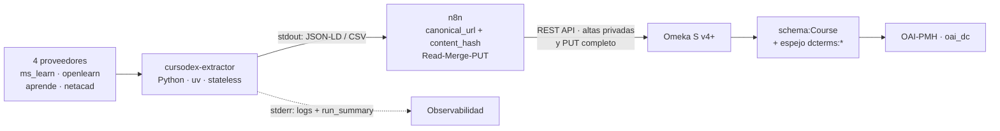

# Cursodex Extractor

**Cursodex Extractor** es el CLI de extracción, normalización y serialización semántica del proyecto académico Cursodex (TFM). Construye un índice abierto e interoperable de cursos gratuitos: enlaza a los proveedores originales sin alojar sus contenidos, descarta cursos que requieren pago y deja los registros incompletos señalados para curaduría humana.

El extractor es stateless y no contiene base de datos ni cliente de Omeka S. Emite JSON-LD o CSV; **n8n** coordina la deduplicación y las escrituras seguras, mientras **Omeka S v4+** conserva el catálogo como fuente de verdad y expone Schema.org y Dublin Core para cosecha OAI-PMH.

## Arquitectura



En n8n, `canonical_url` identifica el curso y `content_hash` permite detectar cambios descriptivos. Las actualizaciones siguen **Read-Merge-PUT**: leer el recurso, combinar los campos y enviar el recurso completo mediante `PUT`. Los datos nunca se escriben directamente en Omeka S desde este CLI.

## Proveedores activos en v0.5.0

| Identificador | Fuente y motor | Idioma predominante | Política de acceso |
|---|---|---|---|
| `ms_learn` | Microsoft Learn; API JSON, `learningPaths` por defecto | Inglés y español | Catálogo gratuito; marca credencial según los datos del proveedor |
| `openlearn` | The Open University; sitemap `.xml.gz`, `extruct` y DOM de fichas | Inglés | Certificado/insignia solo si la ficha declara evidencia gratuita explícita |
| `aprende` | Aprende.org; API JSON (lista raíz o contenedores) y detalle perezoso | Español | Cursos gratuitos con credencial según el proveedor |
| `netacad` | Cisco Networking Academy; SPA con Playwright | Inglés y otros | Solo acepta tarjetas con precio gratuito explícito; credencial solo con evidencia explícita |

HubSpot Academy no forma parte del catálogo activo. Se retiró tras comprobar que su sitemap ya no publicaba rutas `/courses/` y que la página observada era una shell SPA sin datos de curso aprovechables en HTML estático.

OpenLearn usa HTTP directo para sitemaps y páginas. Si el proveedor devuelve 403 o un desafío antibot, el extractor registra el bloqueo y no intenta sortearlo automáticamente; un 503 permite probar las alternativas HTTP documentadas.

El catálogo y sus estrategias se declaran en [`mappings/providers.yml`](mappings/providers.yml) y se validan con Pydantic. `StrategyRunner` aplica las estrategias en orden, corta reintentos sobre hosts bloqueados por WAF y utiliza `BatchQualityGate` para descartar únicamente fichas sin metadatos nucleares. La descripción puede faltar sin invalidar un curso. El driver genérico `sitemap_jsonld` permite incorporar fuentes estándar con una entrada YAML.

## Inicio rápido

Requisitos: Python 3.11+, [`uv`](https://docs.astral.sh/uv/) y Chromium de Playwright para NetAcad. Usa `uv` para instalar y ejecutar el proyecto.

### Windows PowerShell

```powershell
git clone https://github.com/eddiebardad/cursos.git
Set-Location cursos
uv sync --frozen --link-mode=copy
uv run playwright install chromium
uv run cursodex run --provider ms_learn --limit 5 --output -
```

### Linux o macOS (Bash)

```bash
git clone https://github.com/eddiebardad/cursos.git
cd cursos
uv sync --frozen --link-mode=copy
uv run playwright install chromium
uv run cursodex run --provider ms_learn --limit 5 --output -
```

`--output -` infiere JSON-LD. El JSON del catálogo sale por `stdout`; logs y el evento `run_summary` salen por `stderr`.

## Opciones del CLI

Ayuda verificada con `uv run cursodex run --help`:

| Opción | Descripción | Valor por defecto |
|---|---|---|
| `--url`, `-u` | URL de catálogo o curso; el dominio detecta el proveedor | — |
| `--provider`, `-p` | Identificador del manifiesto o `all` | — |
| `--output`, `-o` | Archivo CSV/JSON-LD o `-` para `stdout` (JSON-LD por defecto) | `results.csv` |
| `--format`, `-f` | `csv` o `jsonld`; si se omite, se infiere y `-` usa JSON-LD por defecto | inferido |
| `--limit`, `-l` | Máximo de cursos válidos; `0` no limita | `0` |
| `--render` | Renderizado JavaScript con Playwright; NetAcad siempre lo usa | desactivado |
| `--enable-bfs` | Activa BFS para sitios sin proveedor; apagado por defecto | desactivado |
| `--enable-modules` | Incluye módulos de Microsoft Learn además de learning paths | desactivado |
| `--max-pages` | Máximo de páginas para el rastreador BFS genérico | `100` |
| `--skip-waf-sensitive` | Omite proveedores sensibles a WAF junto con `--provider all` | desactivado |

```bash
uv run cursodex providers
uv run cursodex providers --format json
uv run cursodex run --provider all --skip-waf-sensitive --limit 20 --output -
```

Ejemplos:

```bash
# CSV para revisión o importación
uv run cursodex run -p openlearn --limit 20 --output openlearn.csv --format csv

# Ficha individual detectada por dominio
uv run cursodex run --url "https://www.open.edu/openlearn/..." --output curso.jsonld

# Microsoft Learn: incluir módulos (desactivados por defecto)
uv run cursodex run -p ms_learn --enable-modules --limit 10 --output -
```

## Formatos y códigos de salida

- **JSON-LD**: array de ítems Omeka S v4+, con `property_id: "auto"`, recurso privado por defecto, propiedades Schema.org y espejo Dublin Core.
- **CSV**: UTF-8 sin BOM, cabeceras canónicas y listas multivalor delimitadas por `;`.
- **Códigos**: `0` = al menos un curso; `1` = error técnico o de argumentos; `2` = cero cursos sin error técnico.

## Taxonomía Cursodex

El vocabulario de [mappings/vocab_map.yml](mappings/vocab_map.yml) contiene **17 etiquetas canónicas** basadas en UNESCO CINE-F 2013 y complementadas por DigComp 2.2, DigCompEdu, EntreComp, LifeComp y GreenComp. El ajuste léxico de esta versión mejora la clasificación de Windows/endpoints y la observabilidad cloud sin cambiar las etiquetas canónicas.

| # | Código CINE-F | Categoría |
|---:|---|---|
| 1 | `0613` | Ciencia de Datos e Inteligencia Artificial |
| 2 | `0612` | Redes, Cloud y Ciberseguridad |
| 3 | `0613` | Programación y Desarrollo de Software |
| 4 | `0414` | Marketing Digital y Comercio Electrónico |
| 5 | `0011` | Competencias Digitales y Ofimática |
| 6 | `061` | Tecnologías de la Información y la Comunicación (General) |
| 7 | `04` | Administración de Empresas y Derecho |
| 8 | `07` | Ingeniería, Industria y Construcción |
| 9 | `05` | Ciencias Naturales, Matemáticas y Estadística |
| 10 | `08` + `052` | Sostenibilidad, Medio Ambiente y Agroalimentación |
| 11 | `09` | Salud y Bienestar |
| 12 | `01` | Educación y Pedagogía |
| 13 | `021` + `022` + `0232` | Artes, Diseño y Humanidades |
| 14 | `03` | Ciencias Sociales, Periodismo e Información |
| 15 | `0231` | Idiomas |
| 16 | `0031` | Desarrollo Personal y Habilidades Transversales |
| 17 | `101`–`104` | Hostelería, Turismo y Servicios |

La categoría **#13** incluye artes, humanidades, Filología, Literatura y Lingüística (`0232`); **#15** corresponde a adquisición y aprendizaje de lenguas (`0231` / MCER). Se prioriza la coincidencia léxica más larga para distinguir, por ejemplo, *English literature* de *English language learning*.

Para el alcance disciplinar, fronteras entre categorías, lista completa de disparadores y contrato previsto para rutas `schema:ItemList`, consulta el [manual maestro de taxonomía](docs/TAXONOMY.md).

## Estructura del repositorio

```text
README.md · ARCHITECTURE.md · PLAN.md · AGENTS.md
cli.py · config.py · pyproject.toml · uv.lock
.agent/rules/cursodex.md · .github/copilot-instructions.md
core/
  crawler.py · extractor.py · parser.py · exceptions.py · manifest.py
  drivers.py · strategy.py · quality.py
providers/
  base.py · ms_learn.py · openlearn.py · aprende.py · netacad.py · __init__.py
schemas/
  models.py · __init__.py
mappings/
  vocab_map.yml · providers.yml
exporters/
  base.py · jsonld_exporter.py · csv_exporter.py · __init__.py
utils/
  logger.py · __init__.py
tests/
  test_models.py · test_providers.py · test_extractor_and_crawler.py
  test_core_architecture.py · test_exporters_and_cli.py · __init__.py
docs/
  TAXONOMY.md · USER_GUIDE.md · index.html
legacy/
  scripts retirados, ignorados por Git
```

## Documentación

- [Taxonomía normativa y guía semántica](docs/TAXONOMY.md)
- [Guía de usuario y operación](docs/USER_GUIDE.md)
- [Manual visual HTML](docs/index.html)
- [Arquitectura y contratos](ARCHITECTURE.md)
- [Plan técnico](PLAN.md)
- [Guardrails para agentes](AGENTS.md)
- [Instrucciones de Copilot](.github/copilot-instructions.md)

## Desarrollo y verificación

```bash
uv run pytest -v
uv run ruff check .
uv run mypy cli.py config.py schemas/ exporters/ utils/ core/ providers/ tests/
```

La metadata del paquete declara licencia MIT en [pyproject.toml](pyproject.toml); no se incluye un archivo `LICENSE` en esta versión.
