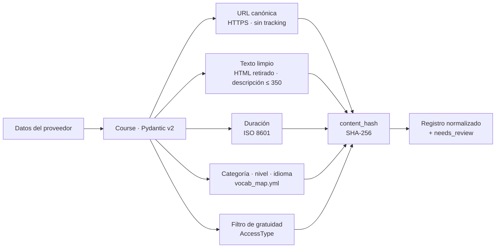

# Guía de usuario y operación

Guía práctica para ejecutar Cursodex Extractor v0.3.0, revisar sus resultados y prepararlos para la curaduría en Omeka S. El extractor solo indexa metadatos y enlaza al proveedor: no descarga ni aloja el contenido del curso.

## 1. Instalación desde cero

### Requisitos

- Python 3.11 o superior.
- [`uv`](https://docs.astral.sh/uv/) instalado y disponible en `PATH`.
- Chromium de Playwright para NetAcad, proveedor cuyo catálogo se renderiza como SPA.
- Acceso de red a los catálogos públicos. El cliente aplica un User-Agent identificable y pausas de cortesía.

### Windows PowerShell

```powershell
git clone https://github.com/eddiebardad/cursos.git
Set-Location cursos
uv sync --frozen --link-mode=copy
uv run playwright install chromium
uv run cursodex --help
uv run cursodex run --help
uv run pytest -v
```

### Linux o macOS (Bash)

```bash
git clone https://github.com/eddiebardad/cursos.git
cd cursos
uv sync --frozen --link-mode=copy
uv run playwright install chromium
uv run cursodex --help
uv run cursodex run --help
uv run pytest -v
```

No es necesario instalar dependencias con `pip`: `uv sync --frozen` usa el lockfile del proyecto. La instalación de Chromium se ejecuta una vez por entorno.

### Configuración por entorno

Las variables opcionales se leen en [config.py](../config.py) al iniciar el proceso. Los valores predeterminados son:

| Variable | Predeterminado | Uso |
|---|---:|---|
| `USER_AGENT` | `CursodexBot/1.0 (+https://cursodex.com; academic research index)` | Identifica el tráfico del extractor. Mantén una identidad clara y de investigación. |
| `HTTP_TIMEOUT` | `30.0` segundos | Timeout de las solicitudes HTTP. |
| `COURTESY_DELAY` | `1.0` segundo | Pausa mínima entre solicitudes del cliente HTTP. |
| `MAX_RESULTS` | `0` | Variable declarada en la configuración, pero no conectada al CLI en v0.3.0; usa `--limit` para limitar una ejecución. |
| `LOG_LEVEL` | `INFO` | Nivel de logging enviado a `stderr`. |

Ejemplo temporal en PowerShell:

```powershell
$env:COURTESY_DELAY = "1.0"
$env:HTTP_TIMEOUT = "30"
uv run cursodex run -p openlearn --limit 5 --output -
```

Ejemplo temporal en Bash:

```bash
COURTESY_DELAY=1.0 HTTP_TIMEOUT=30 \
  uv run cursodex run -p openlearn --limit 5 --output -
```

## 2. Recetario práctico

Los cuatro proveedores activos son `ms_learn`, `openlearn`, `aprende` y `netacad`. Si se alcanza un fallo técnico, el proceso termina con código `1`; si la consulta funciona pero no encuentra cursos, termina con código `2`.

### Prueba rápida por proveedor

```bash
uv run cursodex run -p ms_learn --limit 5 --output -
uv run cursodex run -p openlearn --limit 5 --output -
uv run cursodex run -p aprende --limit 5 --output -
uv run cursodex run -p netacad --limit 5 --output -
```

Las órdenes imprimen un array JSON-LD por `stdout`; los mensajes y `run_summary` permanecen en `stderr`. NetAcad usa Playwright por defecto; no requiere `--render`.

### CSV para Omeka S: CSV Import / Bulk Import

```bash
uv run cursodex run -p aprende --limit 100 --output aprende.csv --format csv
```

Al configurar la importación en Omeka S:

1. Selecciona el CSV como fuente y asigna las columnas `dcterms:*` y `schema:*` a las propiedades correspondientes.
2. Usa codificación **UTF-8** (el archivo se emite sin BOM).
3. Configura `;` como separador de valores multivalor, por ejemplo para autores, keywords y notas de revisión.
4. Revisa antes de publicar: los registros son generados como metadatos de curaduría, no una aprobación editorial automática.

El exportador sustituye los puntos y comas que ya existan dentro de un elemento por comas antes de unir la lista, para conservar el separador `;` como delimitador.

### JSON-LD a archivo

```bash
uv run cursodex run -p openlearn --limit 20 --output openlearn.jsonld
```

Para consumirlo como entrada de Omeka S mediante el flujo de n8n, valida primero el JSON y realiza el patrón **Read-Merge-PUT** en el orquestador. El CLI no llama a la API de Omeka S.

### Tuberías Unix y separación de canales

`--output -` selecciona JSON-LD si no se especifica otro formato. `stdout` se reserva para los datos; `stderr` lleva logs y el resumen estructurado.

**Bash: guardar datos y logs por separado**

```bash
uv run cursodex run -p ms_learn --limit 5 --output - \
  > cursos.jsonld 2> ejecucion.log
```

**Bash: pasar únicamente JSON al siguiente proceso**

```bash
uv run cursodex run -p openlearn --limit 5 --output - 2> ejecucion.log \
  | jq '.[]."schema:name"[0]["@value"]'
```

**PowerShell: guardar datos y logs por separado**

```powershell
uv run cursodex run -p ms_learn --limit 5 --output cursos.jsonld `
  2> ejecucion.log
```

**PowerShell: validar JSON del canal de datos**

```powershell
uv run cursodex run -p openlearn --limit 5 --output - 2> ejecucion.log |
  ConvertFrom-Json
```

El array JSON-LD puede ser `[]` si no se obtuvo ningún curso. En ese caso revisa el código de salida y `run_summary` en el log; el contenido de `stderr` no forma parte del JSON.

### Opciones avanzadas

**Microsoft Learn: añadir módulos**, además de `learningPaths` (que son el comportamiento predeterminado):

```bash
uv run cursodex run -p ms_learn --enable-modules --limit 10 --output -
```

**Procesar una ficha individual** pasando la URL concreta del curso. El dominio permite seleccionar el adaptador:

```bash
uv run cursodex run --url "https://www.open.edu/openlearn/<area>/<curso>" --output -
```

Reemplaza `<area>/<curso>` con la ruta real de la ficha. Para los proveedores con extracción por ficha, el modo individual evita recorrer el catálogo.

**BFS genérico, activado deliberadamente**, para una URL que no tenga proveedor específico:

```bash
uv run cursodex run --url "https://example.org/catalog" \
  --enable-bfs --max-pages 20 --limit 10 --output resultados.csv
```

El rastreo BFS permanece desactivado por defecto. Limita páginas y resultados para mantener el rastreo acotado y respetuoso.

## 3. Normalización y triaje automático

Cada proveedor entrega datos de origen al modelo Pydantic estático `Course`. El modelo central aplica la normalización común; los adaptadores no duplican estas reglas.



- **URLs**: fuerza HTTPS, normaliza el host, elimina fragmentos y parámetros de tracking, conservando parámetros funcionales. Se rechazan URLs sin una ruta de recurso.
- **Textos**: decodifica entidades HTML, elimina etiquetas y colapsa espacios. La descripción se trunca limpiamente a un máximo de 350 caracteres.
- **Duraciones**: se normalizan a ISO 8601, por ejemplo `3 horas` → `PT3H`, `90 min` → `PT1H30M` y `2 semanas` → `P2W`.
- **Acceso**: `free_with_certificate`, `free_audit_paid_certificate` o `free_no_certificate`. Un curso de pago obligatorio o de prueba temporal se rechaza; no se considera gratuito por el mero hecho de ofrecer una prueba.
- **Identidad**: `content_hash` es SHA-256 determinista de campos descriptivos y pedagógicos. No incluye timestamps ni notas de revisión.

### Qué significa `needs_review`

El modelo activa `needs_review = true` y añade motivos a `review_notes` si falta descripción o tiene menos de 30 caracteres, falta idioma, la categoría queda como `Pendiente_Categoria` o la duración suministrada no se puede interpretar. La ausencia de nivel educativo por sí sola no activa revisión.

Cuando la categoría queda pendiente:

1. El valor se conserva en `_cursodex_meta.category` para n8n y la curaduría.
2. No se emiten `schema:about` ni `dcterms:subject` públicos, evitando crear facetas RDF engañosas.
3. El registro queda marcado para revisión; no se inventa una categoría.

## 4. Vocabulario controlado oficial

Fuente normativa: [mappings/vocab_map.yml](../mappings/vocab_map.yml). Las categorías se evalúan en orden de especificidad; las etiquetas canónicas son:

| Código CINE-F / referencia | Etiqueta canónica |
|---|---|
| `0613 / DigComp 2.2` | Ciencia de Datos e Inteligencia Artificial |
| `0612 / DigComp 2.2` | Redes, Cloud y Ciberseguridad |
| `0613 / DigComp 2.2` | Programación y Desarrollo de Software |
| `0414 / DigComp 2.2` | Marketing Digital y Comercio Electrónico |
| `0011 / DigComp 2.2` | Competencias Digitales y Ofimática |
| `061` | Tecnologías de la Información y la Comunicación (General) |
| `04` | Administración de Empresas y Derecho |
| `07` | Ingeniería, Industria y Construcción |
| `05` | Ciencias Naturales, Matemáticas y Estadística |
| `09` | Salud y Bienestar |
| `01` | Educación y Pedagogía |
| `02` | Artes y Humanidades |
| `03` | Ciencias Sociales, Periodismo e Información |
| `023` | Idiomas y Filología |
| `10` | Servicios y Desarrollo Personal |

**Niveles educativos canónicos**: `Principiante`, `Intermedio`, `Avanzado`.

**Idiomas ISO 639-1 configurados**: `es` (español), `en` (inglés), `pt` (portugués), `fr` (francés), `de` (alemán), `it` (italiano). El adaptador puede producir `None` si el dato de origen no permite normalizar el idioma; el modelo lo señalará para revisión.

## 5. Códigos de salida

| Código | Significado | Acción sugerida |
|---:|---|---|
| `0` | Éxito: uno o más cursos válidos | Revisar resultado y `needs_review`; continuar el flujo de curaduría |
| `1` | Error técnico, de red, parsing o argumentos | Consultar `stderr` y `run_summary`; corregir configuración o reintentar más tarde |
| `2` | Ejecución técnica completada, pero sin cursos | Revisar posible cambio del proveedor, filtros o URL; no tratarlo como fallo de red |

## 6. Solución de problemas

| Síntoma | Causa probable | Qué hacer |
|---|---|---|
| Playwright indica que falta Chromium | El navegador de automatización no está instalado en ese entorno | Ejecuta `uv run playwright install chromium` y vuelve a intentar |
| Código `2` y salida `[]` | El catálogo no devolvió cursos válidos o cambió su estructura | Lee `run_summary`, comprueba proveedor/URL y confirma manualmente si la página cambió |
| HTTP `401` o `403` | API requiere autorización, bloqueo del proveedor o WAF | Comprueba disponibilidad y condiciones de uso; respeta el bloqueo y no intentes evadir controles |
| Timeout o error de red | Conectividad inestable, proveedor lento o timeout demasiado corto | Reintenta más tarde; si procede, aumenta `HTTP_TIMEOUT` de forma moderada |
| JSON o CSV aparece mezclado con logs | Se capturó `stderr` junto con `stdout` | Separa canales (`> datos 2> logs`); no uses `2>&1` al guardar datos estructurados |
| Tildes o caracteres dañados al abrir CSV en Windows | La aplicación de hojas de cálculo detectó otra codificación | Importa el archivo explícitamente como UTF-8; el CSV se genera sin BOM |
| `needs_review = true` | Faltan campos de calidad o la categoría quedó pendiente | Lee cada elemento de `review_notes` y completa o valida la metadata durante la curaduría |

## 7. Referencias

- [README del proyecto](../README.md)
- [Arquitectura y contratos semánticos](../ARCHITECTURE.md)
- [Plan técnico](../PLAN.md)
- [Guardrails del repositorio](../AGENTS.md)
- [Manual visual HTML](index.html)
